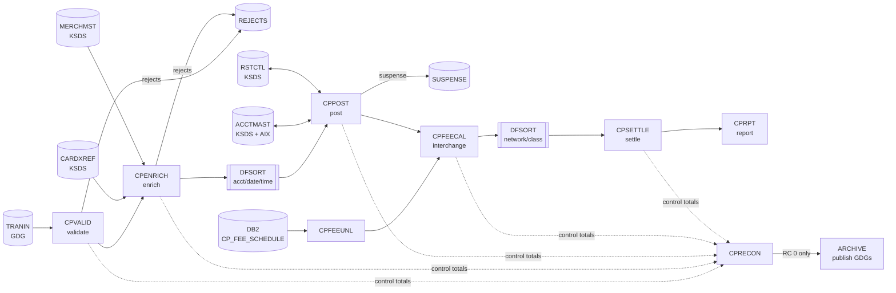

# CLEARPOINT

[](https://github.com/sxmuduganti/clearpoint/actions/workflows/ci.yml)

CLEARPOINT is a card-issuer clearing and settlement system written in
Enterprise COBOL for z/OS. It runs a bank's nightly card back office:
it takes in the day's transactions from the acquiring network,
validates and enriches them, and posts them to cardholder accounts. It
then prices interchange, settles with the card networks and proves to
the penny that nothing was lost along the way.

The batch cycle is fully runnable on Linux with GnuCOBOL. CI builds it,
unit-tests the shared services, runs a 20,000-transaction nightly cycle
and runs a checkpoint/restart test on every push.

## The nightly cycle



| Step     | Program    | What it does |
|----------|------------|--------------|
| FEEUNL   | `CPFEEUNL` | Unloads the interchange rates effective on the business date from DB2 |
| VALID    | `CPVALID`  | Checks the header and trailer (count and hash total), then applies 16 field edits including a Luhn check digit and a presentment window |
| ENRICH   | `CPENRICH` | Looks up the card in the card-to-account cross reference and the merchant in the merchant master, then classifies the merchant category and whether the card was present |
| SORTENR  | DFSORT     | Sorts by account, date, time and transaction id |
| POST     | `CPPOST`   | Updates the account master with checkpoint/restart, high-water-mark idempotency, duplicate detection and over-limit flagging |
| FEECALC  | `CPFEECAL` | Prices each item through a 6-level fallback using a binary search (`SEARCH ALL`) over a table loaded at run time |
| SETTLE   | `CPSETTLE` | Three-level control break (category → network → grand total) giving the net amount due to each network |
| RECON    | `CPRECON`  | Ten balancing rules across every hand-off in the cycle; RC 12 stops publication |
| REPORT   | `CPRPT`    | Paginated settlement report with ASA carriage control |
| ARCHIVE  | IDCAMS     | Publishes rejects, suspense, fee detail and settlement to GDGs only when the cycle is in balance |

## Online and API

| Component  | Type        | What it does |
|------------|-------------|--------------|
| `CPINQ`    | CICS / BMS  | Pseudo-conversational account inquiry (`CPIN`) |
| `CPADJ`    | CICS / DB2  | Maker/checker balance adjustments (`CPAJ`): submit, view, approve, reject, with a full audit trail and one unit of work per action |
| `CPACCAPI` | CICS        | COMMAREA service exposed as `GET /accounts/{accountNumber}` through z/OS Connect ([OpenAPI](api/account-inquiry.yaml)) |

The online components are written for CICS TS and Db2 for z/OS and are
built with `jcl/CPONLBLD.jcl`. They are not compiled in CI because
GnuCOBOL has no CICS or embedded-SQL support.

## Engineering highlights

* **Restartable posting that can't double-post.** A per-account
  high-water mark is written atomically with the balance. A run-control
  record refuses a normal rerun of an incomplete or completed date, and
  checkpoint-key verification catches a restart against the wrong
  input. CI kills a posting run mid-account, restarts it and compares
  the account master byte-for-byte with an uninterrupted run.
* **One master rewrite per account.** Postings are applied in storage
  and written when the account changes, which minimises VSAM I/O and
  keeps a failure inside an account harmless.
* **Control totals everywhere.** Every step emits counts and amounts;
  `CPRECON` proves each step, each sort and the whole cycle balance.
* **Publish on balance.** Generation datasets are created only after
  reconciliation passes, so downstream systems never see an
  out-of-balance day.
* **Defensive by default.** Sequence checks before control breaks and
  posting, file-status checks on every I/O, a single abend handler,
  and reason-coded rejects instead of abends for bad data.
* **Production JCL.** A cataloged procedure with symbolic overrides,
  `COND` logic, DFSORT and ICETOOL, IDCAMS cluster/AIX/path/GDG
  definitions, restart via `RESTART=` and an alert step.

Read more in [docs/design-notes.md](docs/design-notes.md),
[docs/runbook.md](docs/runbook.md) and
[docs/data-dictionary.md](docs/data-dictionary.md).

## Repository layout

```
src/
  batch/      CPVALID CPENRICH CPPOST CPFEECAL CPSETTLE CPRECON CPRPT
              CPMSTLD CPACCUNL
  common/     CPABEND CPDATEU CPLUHN CPINTCH  (called subprograms)
  copybook/   record layouts, parameter areas, BMS symbolic maps
  cics/       CPINQ CPADJ CPACCAPI
  bms/        CPINQM CPADJM
  db2/        CPFEEUNL
  dclgen/     DCLFEE DCLADJ DCLAUD
  ddl/        CPTABLES.sql
tests/        TCLUHN TCDATEU TCINTCH  (unit test drivers)
jcl/          CPNIGHT CPRESTRT CPDEFINE CPLOAD CPBUILD CPONLBLD CPDB2BLD
proclib/      CPNIGHTP  (nightly cycle procedure)
parmlib/      control cards, sort and IDCAMS statements
api/          OpenAPI definition for the z/OS Connect service
tools/        test data generator, DFSORT stand-in, ASA print formatter
scripts/      build, unit test, full cycle and restart test drivers
```

## Running it locally

Requirements: GnuCOBOL 3.x and Python 3.

```bash
sudo apt-get install gnucobol        # or: brew install gnucobol

bash scripts/build.sh                # compile with -std=ibm
bash scripts/test-unit.sh            # Luhn, date service, rate engine
bash scripts/run-cycle.sh 20000      # full nightly cycle
bash scripts/test-restart.sh         # kill, refuse rerun, restart, compare
```

`run-cycle.sh` generates a deterministic data set with about 3.5%
deliberately defective transactions, so every reject and suspense path
is exercised. It then loads the VSAM-equivalent masters, runs every
step with DD names mapped to files, and prints the reconciliation and
settlement reports.

## Running it on z/OS

1. Allocate libraries and copy `src/**` to `CP.PROD.SOURCE` /
   `CP.PROD.COPYLIB`, `proclib/` to `CP.PROD.PROCLIB` and `parmlib/` to
   `CP.PROD.PARMLIB`.
2. Run `src/ddl/CPTABLES.sql` through SPUFI or DSNTEP2.
3. Submit `CPDEFINE` (GDGs and VSAM), then `CPBUILD`, `CPDB2BLD`
   and `CPONLBLD`.
4. Submit `CPLOAD` to load the masters from conversion extracts.
5. Schedule `CPNIGHT`. Use `CPRESTRT` as described in the runbook.

## Return code conventions

| RC | Meaning |
|----|---------|
| 0  | Normal |
| 4  | Normal with exceptions (rejects or suspense written) |
| 12 | Cycle out of balance; outputs withheld |
| 16 | Processing stopped; see the `CPABEND` block in SYSOUT |

## License

MIT
